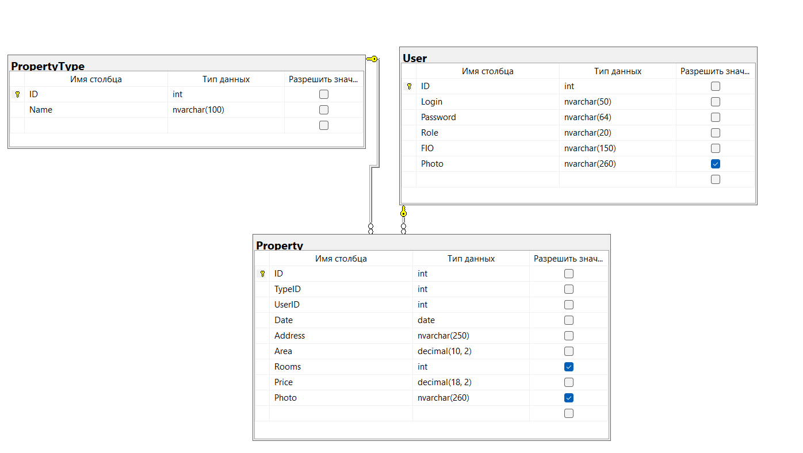

# AuroraApartments

Учебная практика УП.01.01. Тема: «Проектирование и разработка базы данных для системы управления агентством недвижимости».

Выполнил: Русаков Артём Сергеевич, группа 4ИСИП-123.
Преподаватель: Аксёнова Т.Г.

## Описание работы

WPF-приложение для агентства недвижимости, которое работает с базой данных MS SQL Server `DB_Rusakov_RealEstate`.

Что реализовано:

- авторизация и регистрация, роли «Пользователь» (User) и «Администратор» (Admin);
- хэширование паролей (SHA-256);
- капча после трёх неудачных попыток входа;
- смена пароля;
- пользователь: просмотр каталога объектов, поиск по адресу, фильтр по типу, «только мои объекты», сортировка по цене и площади;
- администратор: всё то же самое, плюс:
  - добавление, редактирование и удаление пользователей, типов недвижимости и объектов;
  - диаграмма стоимости объектов агента по типам недвижимости;
  - экспорт отчёта в Word (.docx), PDF и Excel (.xlsx);
- два словаря стилей: `Dictionary.xaml` по руководству по стилю и собственный `RusakovDictionary.xaml` (тёмная тема); тема переключается кнопкой и сохраняется после выхода;
- динамический заголовок страниц, плейсхолдеры и всплывающие подсказки;
- проверка вводимых данных, ограничения ввода, минимальные и максимальные значения;
- подтверждение выхода и удаления, каскадное удаление.

## Структура решения

```
UP01_Rusakov_RealEstate/
├── README.md
├── db/
│   ├── schema.sql              скрипт создания БД с тестовыми данными
│   └── diagram.png             схема данных
├── res/                        ресурсы: иконка, логотип, шрифт Open Sans
├── UP01_Rusakov_RealEstate.sln
└── UP01_Rusakov_RealEstate/
    ├── App.xaml, App.config    запуск приложения, строка подключения
    ├── MainWindow.xaml         главное окно (шапка, Frame, нижняя строка)
    ├── Dictionary.xaml         словарь стилей по руководству по стилю
    ├── RusakovDictionary.xaml  собственный словарь стилей
    ├── Classes/Helper.cs       хэширование, авторизация, капча, сообщения, темы
    ├── Model/                  классы таблиц и контекст БД Entities
    └── Pages/                  страницы приложения
```

Страницы:

| Страница | Назначение |
|---|---|
| AuthPage | авторизация, капча |
| RegPage | регистрация |
| ChangePassPage | смена пароля |
| UserPage | каталог объектов |
| AdminPage | панель администратора |
| UsersTabPage, AddUserPage | пользователи |
| PropertyTypeTabPage, AddPropertyTypePage | типы недвижимости |
| PropertyTabPage, AddPropertyPage | объекты недвижимости |
| DiagrammPage | диаграмма и экспорт |

## База данных

| Таблица | Поля |
|---|---|
| User | ID, Login, Password, Role, FIO, Photo |
| PropertyType | ID, Name |
| Property | ID, TypeID, UserID, Date, Address, Area, Rooms, Price, Photo |

Связи `User — Property` и `PropertyType — Property` имеют тип «один ко многим», удаление каскадное.



## Тестовые учётные записи

| Логин | Пароль | Роль |
|---|---|---|
| admin | Admin2026 | Admin |
| manager | Manager1 | Admin |
| petrov | Agent111 | User |
| kuznetsova | Agent222 | User |
| sokolov | Agent333 | User |
| user | User123 | User |
